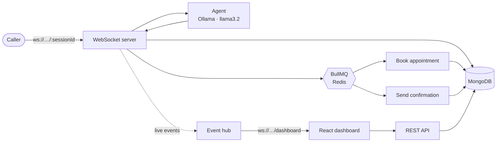

<h1 align="center">Callflow</h1>

<p align="center">
  <b>The service desk that never misses a call.</b><br>
  A local AI assistant that talks to callers, qualifies the lead and books the appointment.<br>
  Runs entirely on your own machine. No cloud AI, no API bill, no customer data leaving the building.
</p>

<p align="center">
  
  
  
  
  
</p>

<!-- Add a screenshot: save it as docs/dashboard.png, then remove these comment markers
<p align="center"></p>
-->

---

## A call, start to finish

> *Illustrative conversation. The agent asks for one missing detail at a time.*

```
Caller   Hi, I want to book a service.
Agent    What type of service are you looking to book?
Caller   An oil change, this Friday.
Agent    Sure. Could I have your name for the booking?
Caller   Ravi.
Agent    Thanks Ravi, your oil change request for Friday is noted.
         A confirmation will follow shortly.
```

Behind that exchange, Callflow:

1. works out the intent and pulls out the service, name, phone, vehicle and day,
2. turns "this Friday" into a real calendar date in code, so the model can't get it wrong,
3. books a free 30 minute slot (10:00 preferred, 9:00 to 5:00),
4. queues the confirmation and retries it if the provider is down,
5. shows every step live on the staff dashboard.

---

## Why it's built this way

**Local first.** The model runs through [Ollama](https://ollama.com). Nothing is sent to a third party, there is no per-message cost, and it works with the internet off.

**The model suggests, the code decides.** Small models are good at conversation and bad at arithmetic. Dates, slot allocation and booking rules are plain code, with unit tests, and they override anything the model says. A reply that claims "you're booked" before the name, service and day are known is replaced with a question.

**Failure is expected.** Bookings retry 3 times and confirmations 5, with exponential backoff. Jobs that run out of retries are kept as dead jobs with their error, a person can replay them from the dashboard, and failed bookings escalate the conversation to a human.

---

## How it fits together



| Layer | Technology |
|---|---|
| Server | Node.js, Express, `ws` |
| Data | MongoDB, Mongoose |
| Queues | Redis, BullMQ |
| Model | Ollama (`llama3.2`), optional Claude |
| Dashboard | React 18, Vite 5, Tailwind CSS 3 |

---

## Get it running

You need **Node 18.18+**, **MongoDB**, **Redis** and **Ollama** (`ollama pull llama3.2`).

```bash
git clone https://github.com/aahanamalla26-prog/callflow.git
cd callflow
cp .env.example .env          # fill in your values
```

```bash
# terminal 1: the server on :4000
cd server && npm install && npm start

# terminal 2: the dashboard on :5173
cd client && npm install && npm run dev
```

Then be the caller:

```bash
npx wscat -c ws://localhost:4000/demo1
> {"text":"Hi, I'd like an oil change this Friday. My name is Ravi."}
```

Keep the dashboard open while you type. The conversation, messages and booking appear without a refresh.

---

## The dashboard

A single screen for the service desk:

- **Numbers at a glance**: confirmed appointments, conversations, bookings from chat, leads, failed jobs and average reply time.
- **Appointments**: an agenda grouped by day.
- **Conversations**: who called, what they want, how it ended, filterable by status.
- **Live activity**: a feed of every message and update as it happens, with a connection light that reconnects by itself.
- **Background jobs**: retries, errors and a one-click **Replay** for dead jobs.

---

<details>
<summary><b>REST API</b></summary>

<br>

Read-only, except for replaying a job. Lists return `{ "items": [...] }`, newest first. `limit` defaults to 25 and is capped at 100. Bad filters return `400` with a clear message.

| Method | Path | Notes |
|---|---|---|
| GET | `/api/stats` | Counts per status and average reply time |
| GET | `/api/conversations` | `?status=&limit=` |
| GET | `/api/conversations/:id` | With lead, appointment and messages |
| GET | `/api/leads` | `?status=&limit=` |
| GET | `/api/appointments` | `?status=&when=upcoming\|past&limit=` |
| GET | `/api/jobs` | `?status=&queue=&limit=` |
| GET | `/api/jobs/:id` | Includes the error stack |
| POST | `/api/jobs/:id/replay` | Re-queue a dead job |

</details>

<details>
<summary><b>Live events</b></summary>

<br>

Connect to `ws://localhost:4000/dashboard`. Every frame is `{ "type": "…", "data": {…}, "ts": "…" }`.

`message.created` · `message.updated` · `conversation.updated` · `lead.updated` · `appointment.updated` · `job.updated`

</details>

<details>
<summary><b>Configuration</b></summary>

<br>

Set these in `.env` (see `.env.example` for the full list).

| Variable | Purpose | Default |
|---|---|---|
| `OLLAMA_URL` | Where Ollama is running | `http://localhost:11434` |
| `OLLAMA_MODEL` | Model used for replies | `llama3.2` |
| `ANTHROPIC_API_KEY` | Optional. If set, Claude is used instead of Ollama | not set |

</details>

<details>
<summary><b>Tests</b></summary>

<br>

```bash
cd server && npm test
```

The booking logic (slot allocation, idempotency, double-booking) is covered by offline unit tests that need no database.

</details>

---
### ⚡ Performance & Benchmarking

- **Average Response Latency**: **~1.8s** on Apple Silicon (MacBook Air) using local `llama3.2` via Ollama.
- **Accuracy**: **15/15 (100%)** on a fixed evaluation test suite.
- **Optimizations Applied**:
  - Model context retention via `keep_alive: "30m"`.
  - Generation constraints (`num_predict: 200`, `num_ctx: 4096`).
  - Leaner JSON schema payload to minimize token output overhead.
- **Reproducibility**: Run `node scripts/measure.js tuned` inside `/server` to verify latency and accuracy locally.

## Honest limits

- **No login yet.** Anyone who can reach port 4000 can read customer details and replay jobs. Keep it on a trusted network for now.
- **Reply speed.** about 2 s per reply locally, still too slow for natural phone conversation.
- **Confirmations are simulated.** No real SMS goes out yet.

## Next

- [ ] Login for the API and dashboard socket
- [ ] Click a conversation to read the full transcript
- [ ] Faster replies: shorter prompt, tuned Ollama options
- [ ] A real SMS provider for confirmations
- [ ] Voice in and out
